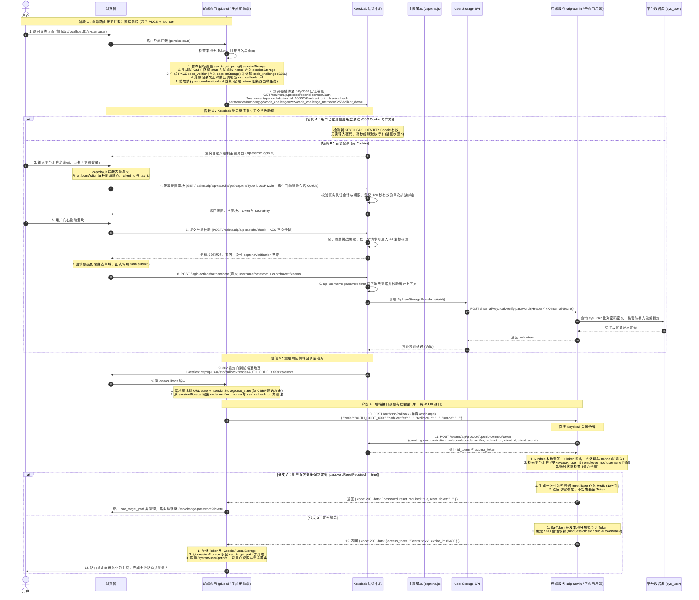
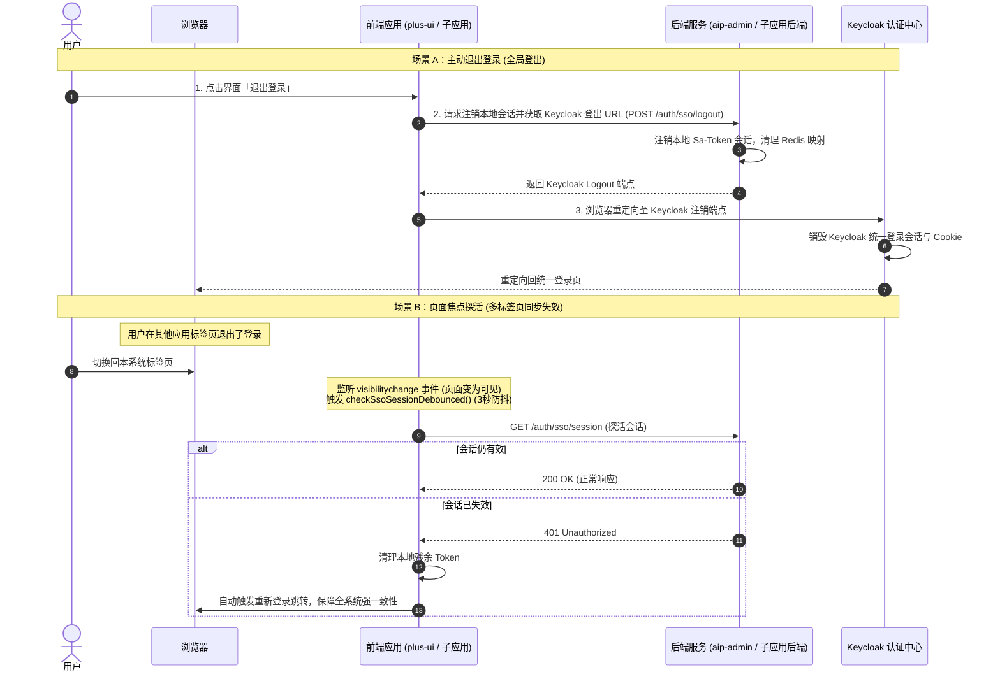

# Keycloak 全链路 SSO 统一身份认证与登录鉴权流程详解（纯 SPA 前端落地 + 后端单一接口架构）

> **文档版本**：v2.1（纯 SPA 前端落地 + 强安全闭环版）  
> **编写团队**：集成平台架构与研发团队  
> **最后修订日期**：2026年11月02日  
> **适用对象**：架构师、前后端开发工程师、实施交付人员  
> **核心目标**：阐明平台门户（`plus-ui` + `aip-admin`）及各子应用统一采用 **纯 SPA 前端落地 + 强制 PKCE / Nonce 防护 + 后端单一 JSON 换票接口** 的登录鉴权流程、角色交互时序与安全设计原理。

---

## 一、核心设计理念（30秒弄懂整体逻辑）

在阅读时序之前，请先记住 **三个最核心的设计原则**：

1. **用户与密码主库仍然在平台数据库（`sys_user`）**：
   * **Keycloak 不保存用户的密码**。Keycloak 仅仅作为一个标准的 OIDC 统一身份认证协议代理人；
   * 用户在 Keycloak 登录页输入密码后，Keycloak 通过底层的 **User Storage SPI 插件**，在内网调用集成平台的接口来验证密码。改密、重置密码、连续输错锁定全都在平台自身完成。
2. **Keycloak 负责认证（你是谁），平台 Sa-Token 负责鉴权（你能做什么）**：
   * Keycloak 只负责证明“当前操作者确实是 admin 用户”；
   * 用户认证通过后，平台后端验证 Keycloak 颁发的身份凭据，并在本地换发 **Sa-Token 本地会话 Token**。系统原本的所有 `@SaCheckPermission`、角色、部门数据权限、多租户机制**100% 保持不变，零侵入无缝衔接**。
3. **极简且高安全的直连架构（纯 SPA 前端落地 + 强制 PKCE + 后端单接口）**：
   * **未登录直跳**：前端路由守卫检测无 Token 时，直接在前端拼装 Keycloak 标准 OIDC 授权地址并执行重定向，**无需等待后端网络往返**；
   * **前端落地接 Code**：Keycloak 认证通过后直接 302 重定向到前端路由（`/sso/callback?code=xxx&state=yyy`）；
   * **后端单接口直换 Sa-Token**：前端将 `code`、`codeVerifier`、`redirectUri` 与 `nonce` 通过 `POST /auth/sso/callback` 提交给后端服务，后端直连 Keycloak 换票、严格验签并直接签发 Sa-Token；
   * **彻底告别模式 A 的死代码**：彻底废弃原本的两次 302 跨域重定向与 Redis Ticket/State 临时表，后端退回纯粹的 RESTful 无状态服务。

---

## 二、架构参与角色说明

在整个登录鉴权链路中，共有以下 **5 个参与方**：

```
┌──────────────┐     ┌──────────────┐     ┌────────────────────────┐     ┌────────────────────────┐     ┌──────────────┐
│  终端浏览器  │ ◄─► │ 门户/子应用  │ ◄─► │    keycloak-server     │ ◄─► │       平台后端         │ ◄─► │  平台数据库  │
│  (End User)  │     │ 前端系统     │     │   (Keycloak 统一认证)  │     │       服务             │     │ (Postgres/DB)│
└──────────────┘     └──────────────┘     └────────────────────────┘     └────────────────────────┘     └──────────────┘
```

| 角色 | 运行实体 | 职责与功能 |
| :--- | :--- | :--- |
| **终端浏览器** | Chrome / Edge 等 | 用户操作界面，负责页面渲染、表单填写、拼图滑块人机交互与 URL 重定向跳转。 |
| **前端应用 (`plus-ui` / 子应用)** | Vue 3 / React | 前端系统。未登录时本地生成 `state`、`nonce` 与 PKCE 凭据，直跳 Keycloak；回调时校验 `state` 并将参数提交后端。 |
| **Keycloak 认证中心** | Keycloak 26.x 容器 | 统一身份认证中心。托管定制登录主题 `aip-theme`，装配 `aip-keycloak-user-storage` 用户联合存储 SPI 插件。 |
| **后端服务 (`aip-admin` / 子应用后端)** | Spring Boot | 暴露单一换票接口 `POST /auth/sso/callback`，持 `client_secret` 直连 Keycloak 换票，验签 Nonce，签发 Sa-Token。 |
| **主数据库与缓存** | PostgreSQL + Redis | 存放 `sys_user` 用户信息、密码哈希与锁定状态；Redis 仅维护 SSO 会话映射（用于单点登出）与强制改密凭据。 |

---

## 三、全链路登录时序图（Mermaid Sequence Diagram）

以下是用户访问前端、统一跳转认证、行为人机验证、后端换票并成功进入系统的 **标准时序图**：



---

## 四、五大核心阶段深度原理解析

### 阶段 1：前端为什么能直跳？如何确保 PKCE 与 Nonce 绝对安全？
* **直跳优势**：
  在纯 SPA 模式下，前端直接持有 Keycloak 授权端点 URL 与分配的 Client ID，路由守卫拦截到未登录时，直接在内存构造链接并执行 `window.location.href`。**完全无需先发一次 AJAX 请求问后端要链接**，跳过一次后端 HTTP 往返，登录响应速度提升 30% 以上。
* **防 CSRF（跨站请求伪造）原理**：
  1. 前端在跳转前，在浏览器本地生成一个高强度的随机串：`const state = generateRandomString(32);`；
  2. 将该 `state` 保存在当前浏览器的 `sessionStorage` 中；
  3. 传给 Keycloak，Keycloak 在认证完成后会**原样带回**给回调地址；
  4. 落地页加载后，如果地址栏的 `state` 与本地 `sessionStorage` 记录的 `state` 不一致，直接判定为恶意伪造并阻断。
* **强制 PKCE（Proof Key for Code Exchange）防护原理**：
  1. 前端生成 64 字节高强度随机串 `code_verifier` 存入 `sessionStorage`；
  2. 使用 SHA-256 计算 `code_challenge = Base64URL(SHA256(code_verifier))`，带入授权请求；
  3. Keycloak 暂存该 `code_challenge`；换票时前端将 `code_verifier` 经由后端交给 Keycloak，Keycloak 再次哈希比对。即便授权码 `code` 在浏览器或网络层被拦截，缺乏 `code_verifier` 的黑客依然无法换取任何 Token。
* **OIDC Nonce 防 Token 重放原理**：
  1. 前端生成随机 `nonce` 存入 `sessionStorage`，并拼装在授权链接中；
  2. Keycloak 会将该 `nonce` 原封不动签入颁发的 `id_token` 载荷（Payload）声明中；
  3. 后端调用 `keycloakJwtVerifier.verifyToken(idToken, clientId, bo.getNonce())` 时，严格比对 ID Token 内声明的 `nonce` 是否与请求入参完全一致，杜绝了重放历史 ID Token 的可能。

---

### 阶段 2：非 HTTPS / 内网 IP 环境兼容设计（双引擎 SHA-256）
* **背景与风险**：
  浏览器的 Web Crypto API（`window.crypto.subtle`）属于安全上下文特有 API，仅在 `https://` 或 `http://localhost` 下可用。一旦部署在医院局域网内网 IP（如 `http://192.168.43.100:81`），`window.crypto.subtle` 会直接返回 `undefined`，导致前端计算 `code_challenge` 时抛出 `TypeError` 崩溃白屏。
* **健壮解法（`src/utils/sso.ts` 双引擎）**：
  1. **首选原生**：优先检测 `window.crypto?.subtle?.digest`，若在安全上下文中，采用原生异步微任务进行高性能计算；
  2. **自动兜底**：若在非 HTTPS / 内网 IP 环境下抛错或不支持，无缝回退至前端工程内置的 `crypto-js/sha256` 纯 JS 算法库，生成完全符合 RFC 7636 规范的 URL-Safe Base64 编码，确保无论在任何部署环境下均 100% 稳定运行。

---

### 阶段 3：验证码如何内聚进 Keycloak 并完成服务端校验？
* **解法**：
  1. 验证码接口由主题 JAR 内的 `RealmResourceProvider` 暴露在 `/realms/{realm}/aip-captcha/get`、`/check`，登录页同源调用，无需 `captchaBaseUrl`、CORS 或外部服务；
  2. 登录页从 `${url.loginAction}` 解析 realm、`client_id` 与 `tab_id`，作为参数传入，并携带同源登录会话 Cookie；接口复用 Keycloak 的会话解析和登录期限判断，不接受任意自造 tabId，也不消费登录表单的 active_code；
  3. `/get` 在出图后登记挑战绑定，绑定 realmId、根认证会话 ID、公开 clientId、tabId，TTL 120s。`/check` 先以 `SingleUseObjectProvider.remove()` 原子消费该绑定，再调用 AJ-Captcha 坐标校验，保证同一个挑战并发提交也最多进入引擎一次；
  4. 坐标校验通过后签发绑定同一上下文的一次性登录票据，TTL 180s。登录表单提交时，`aip-username-password-form` 在 `super.action()` 前原子消费票据；无票据、伪造、重放、跨根会话/客户端/tab 或过期票据均直接拒绝；
  5. 每节点固定窗口分别约束 IP 总量（get 120/分钟、check 60/分钟）和认证会话（get 20/分钟、check 10/分钟）；同一节点的会话在窗口内失败 5 次后写入共享 300s 锁，所有节点的 get/check 都查询该锁。容量满时仅清理过期计数，不清空有效状态；
  6. 前端关闭/刷新会取消旧请求和定时器，按挑战轮次忽略晚到的响应，防止取消后自动登录或旧图覆盖新图；SSO Cookie 命中仍走浏览器流的 `Cookie` 分支，不触发验证码。
* **部署前提**：Realm 浏览器流必须绑定 `aip-username-password-form`，否则验证码只展示、不参与服务端校验。

---

### 阶段 4：Keycloak 怎么核验账号密码？（User Storage SPI 联合认证）
* **主数据在平台**：Keycloak 自身数据库不保存任何用户的密码密文；
* **内网调用**：
  0. 浏览器提交的 `captchaVerification` 先由 `aip-username-password-form` 原子消费并校验绑定上下文，失败直接拒绝；
  1. 用户在登录页输入用户名和密码点击登录；
  2. Keycloak 内部的 `aip-keycloak-user-storage` 插件拦截认证动作；
  3. 插件在服务器内网向平台后端发起 HTTP POST：`/internal/keycloak/verify-password`，Header 携带双方约定的 `X-Internal-Secret` 共享防伪密钥；
  4. 平台后端接收请求后，在平台数据库 `sys_user` 中检索用户，执行标准 BCrypt 哈希比对与连续输错锁定策略；
  5. 校验通过后返回 `valid: true`，Keycloak 由此确认凭证合法并签发授权码 `code`。

---

### 阶段 5：后端单一换票接口（`POST /auth/sso/callback`）与首次改密联动
1. 前端落地页 `callback.vue` 从 URL 取出 `code`，从 `sessionStorage` 取出 `code_verifier`、`nonce` 以及登录发起时记录的精确回调地址 `sso_callback_url`；
2. 异步向后端发起 `POST /auth/sso/callback` 请求（强类型对象 `SsoExchangeBo`）；
3. **安全直连与验签**：平台后端在服务端直连 Keycloak 的 `/protocol/openid-connect/token` 接口完成换票，并通过公钥验签 ID Token 签名与 `nonce`；
4. **身份提取**：解析出平台用户的工号（`employee_no`）、Keycloak 用户唯一标识（`sub`）与账号名；
5. **首次强制改密联动**：
   - 若平台用户标记为 `password_reset_required == true`，后端不签发会话 Token，而是生成临时的 `resetTicket` 存入 Redis，返回改密响应；
   - 前端接收后，清理 `sso_target_path`，平滑路由到 `/sso/change-password?ticket=...` 引导用户完成初始密码修改；
6. **本地建会话**：正常登录时，调用 Sa-Token 的 `LoginHelper.login(...)` 签发本地 Token，并将 Keycloak 会话 ID（`sid`）保存在 Redis 会话映射表中，在 JSON 响应体中直接返回 `access_token`。

---

## 五、单点登出（Back-Channel Logout）与多标签页焦点探活



---

## 六、Keycloak 客户端配套运维要求

为确保上述安全闭环机制在 Keycloak 端严格生效，实施团队必须在 Keycloak 管理控制台完成以下客户端配置：

1. **客户端访问类型（Access Type）**：
   - 客户端 `000000` 必须设置为 **Confidential（机密客户端）**，由平台后端持客户端密钥换票。
2. **强制 PKCE 模式（Proof Key for Code Exchange）**：
   - 进入 Clients -> `000000` -> **Advanced Settings**；
   - 找到 **Proof Key for Code Exchange Code Challenge Method**，明确设置为 **S256**（强制开启，任何不带合规 PKCE 凭据的请求均被拒绝）。
3. **有效重定向 URI（Valid Redirect URIs）**：
   - 登记实际运行的前端回调地址，例如：
     - `http://localhost:81/sso/callback`
     - `http://192.168.43.100:81/sso/callback`

---

## 七、常见疑问解答（FAQ）

#### Q1：子应用接入与门户接入有什么区别？
* **完全一样**！这正是该架构的最大优势：**全系统标准统一**。
  * 无论是集成平台门户（`plus-ui` + `aip-admin`），还是外部采购的第三方业务子应用，全部采用完全相同的接入模式；
  * 前端检测无 Token $\rightarrow$ 直跳 Keycloak $\rightarrow$ 落地页拿 Code $\rightarrow$ 后端直连 Keycloak 换票 $\rightarrow$ 建立本地会话进入系统。

#### Q2：为什么彻底淘汰了原本的模式 A 与 Ticket 二次换票机制？
* 在原本的模式 A 中，Keycloak 回调先给到后端，后端无法直接给前端浏览器内存注入变量，只能再 302 重定向一次给前端，且为了安全不能在 URL 传真实 Token，才引入了“60秒 Ticket 表”；但原代码中后端生成了 ticket 却没有任何接口消费它，前端也根本不认 ticket，是完全未闭环的死代码；
* **现行架构的回调直达前端落地页**，前端通过安全的 POST AJAX 异步请求把 Code、PKCE 与 Nonce 提交给后端，后端在安全的 JSON 响应体（HTTP Body）中把真实 Token 交付给前端，**天生具备极高安全性，自然彻底不再需要 Ticket 表与多余的重定向**！

#### Q3：为什么 PKCE 的 code_verifier 由前端生成，而不是后端生成？
* OAuth 2.0 PKCE（RFC 7636）的初衷就是保护**用户代理端（Browser / User Agent）发起的授权流程**；
* 前端直跳避免了登录前必须先请求后端拿 URL 的额外网络开销；前端通过浏览器本地随机生成 `code_verifier` 暂存在 `sessionStorage` 中，授权码返回后再取出提交，由 Keycloak 在服务端完成加密校验，是最标准的工业级实现方案。
