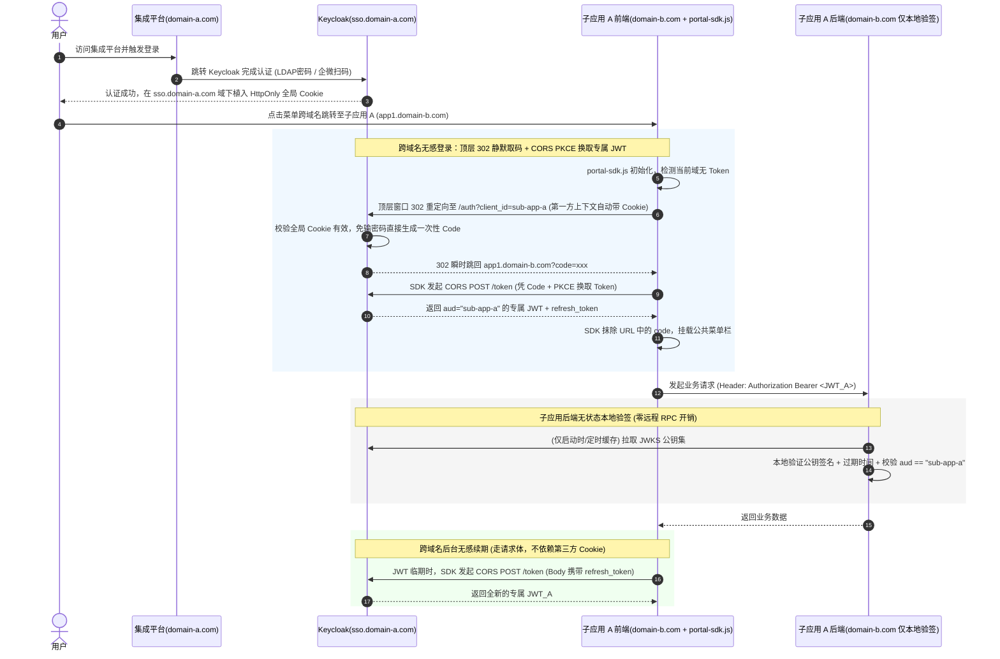
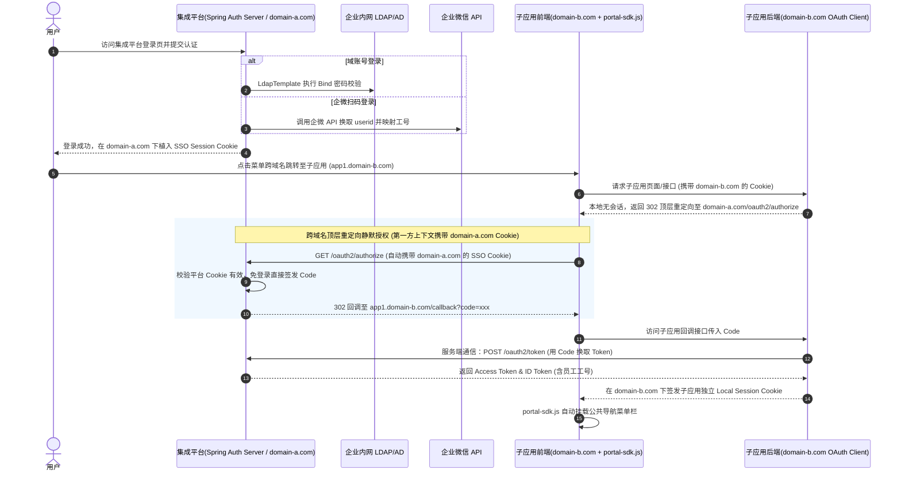
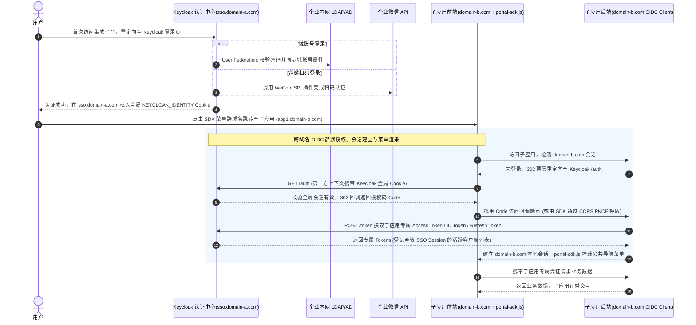

# 集成平台（跨不同域名 + 前端 SDK 植入菜单）单点登录（SSO）技术方案与多账号并发分析

## 一、总体接入架构说明

### 1. 上游身份源与账号归一

* **LDAP**：标准协议，本地部署为主，数据在企业内网服务器；适合 AD 域、自建 OpenLDAP 存量账号，是拉取账号 / 校验密码的通用接口。

* **企业微信身份源**：是微信提供的 HTTP 开放 API，属于云身份源，走 HTTPS，没有 LDAP 树形结构。

* **核心账号对齐**：身份中台同时接入两者，以员工**工号**（或手机号）作为全局唯一关联键，将内网域账号与企业微信 `userid` 绑定映射，统一到一套身份管理中。

### 2. 下游跨域名菜单植入机制：平台统一前端 SDK（`portal-sdk.js`）

`portal-sdk.js` 是由**集成平台前端团队统一封装并托管在 CDN/静态服务器上的公共 JS 脚本**，各异构子应用通过 `<script>` 或 npm 引入

---

## 二、方案一：Keycloak 签发应用专属 JWT + 前端 SDK 跨域静默取票 + 子应用本地公钥验签

### 1. 方案架构与跨域名无感登录机制（不共享 Token）

* **核心逻辑**：
* **认证层**：部署开源 IAM 平台 **Keycloak**（如 `sso.domain-a.com`）对接内网 LDAP 与企业微信，负责维护全局登录会话并按子应用签发专属 JWT。

* **子应用后端（无状态极简改造）**：子应用后端（如 `app1.domain-b.com`）**无需开发 OAuth2 授权码回调接口、无需维护服务端 Session**，仅作为纯粹的无状态**资源服务器（Resource Server）**，使用 Keycloak 的 RSA 公钥在本地内存验签 JWT。

* **跨不同域名下，如何实现“无感登录”与“不共享 Token”？**
1. **顶层重定向突破跨域限制**：用户在集成平台登录后，浏览器在 `sso.domain-a.com` 域下保存了 `HttpOnly` 的全局会话 Cookie。当用户点击菜单跳转到完全不同域名的子应用 A（`app1.domain-b.com`）时，子应用 A 的 `portal-sdk.js` 发现当前域无 Token，立即触发浏览器顶层窗口跳转至 `[sso.domain-a.com/.../auth?client_id=sub-app-a&response_type=code&code_challenge=xxx](https://sso.domain-a.com/.../auth?client_id=sub-app-a&response_type=code&code_challenge=xxx)`。
2. **第一方 Cookie 免密签发**：由于是顶层窗口跳转，浏览器 100% 自动携带 `sso.domain-a.com` 的会话 Cookie。Keycloak 校验通过后**不弹出登录框**，在几毫秒内直接 `302` 重定向回 `app1.domain-b.com?code=xxx`。
3. **CORS 换取专属 JWT（绑定 `aud`）**：子应用 A 前端 `portal-sdk.js` 截取地址栏中的 `code`，直接向 Keycloak 发起 **CORS POST 请求**换取 `sub-app-a` 专属的 `access_token`（Payload 中固定包含 `aud: "sub-app-a"`）和 `refresh_token`，存入当前标签页独立的内存/`sessionStorage` 中。
4. **CORS 无感续期（不依赖 Cookie）**：当专属 JWT 即将过期时，`portal-sdk.js` 在后台直接通过 CORS POST 将 `refresh_token` 放在请求体中发给 Keycloak 换取新 JWT，全程无页面跳转。
5. **子应用后端本地验签 + `aud` 校验**：子应用 A 后端仅用本地缓存的 Keycloak 公钥验签，并校验 `jwt.aud == 'sub-app-a'`。即便子应用 A 的 Token 泄露，拿去调 `app2.domain-c.com` 的后端也会因 `aud` 不匹配直接被拒（`403 Forbidden`）。

### 2. 方案一时序图（跨不同根域名版）

### 3. 优缺点、适用场景与实施关键

* **优点**：
* **子应用后端改造量依然最低**：子应用后端完全不参与 OAuth 重定向与 Code 置换（全由前端 `portal-sdk.js` 内部消化），后端仅需 1 个无状态的公钥 + `aud` 验签拦截器。
* **100% 兼容跨不同域名部署**：通过“顶层重定向取码 + CORS Body 传参续期”，彻底绕开浏览器对跨域名第三方 Cookie 的封锁。
* **Token 按应用严格隔离**：每个子应用拥有独立 `aud` 的 JWT，互不共享，防止横向越权。

* **缺点**：
* 首次跨域名打开新子应用时，地址栏会经历一次极短暂（通常 `<100ms`）的顶层 `302` 重定向跳回。
* 子应用后端无状态，若不配 Redis 黑名单，被抓包窃取的 access_token 在短周期（如 5 分钟）自然过期前仍可通过后端验签。

* **适用场景**：子应用分散在不同根域名下、技术栈各异，希望子应用后端保持最简无状态架构（只做本地公钥验签）的项目。
* **实施关键**：
* 必须在 Keycloak 控制台为每个子应用 Client 配置准确的 `Valid Redirect URIs`（如 `[https://app1.domain-b.com/](https://app1.domain-b.com/)*`）和 **`Web Origins`（配置为 `[https://app1.domain-b.com](https://app1.domain-b.com)` 以允许 CORS 跨域请求 `/token` 接口）**。

---

## 三、方案二：基于 Spring Authorization Server 的标准 OIDC + 前端 SDK 菜单方案

### 1. 方案架构与跨域名无感登录机制

* **核心逻辑**：不部署独立的 Keycloak 中间件，直接在集成平台现有的 Spring Boot 后端服务（如 `sso.domain-a.com`）中引入官方 **`spring-boot-starter-oauth2-authorization-server`** 框架，将集成平台构建为标准的 OIDC 认证中心。
* **中台实现**：编写 `AuthenticationProvider` 调用内网 LDAP 执行 Bind 密码校验，编写企业微信回调接口对接企微 HTTPS API 并关联员工工号。

* **子应用有状态接入**：不同域名下的各子应用后端作为标准的 OAuth Client（不限编程语言），通过后端通道用 `code` 换取 Token，并在**子应用自身域名下建立独立的本地会话（Local Session Cookie）**；子应用前端引入 `portal-sdk.js` 挂载公共菜单。

* **跨域名无感登录（Silent Login）实现**：
1. 用户登录集成平台，浏览器在 `sso.domain-a.com` 下保存平台 SSO Session Cookie。
2. 用户点击菜单跳转至跨域名子应用（`app1.domain-b.com`），子应用后端拦截器发现无 `domain-b.com` 的本地会话，返回 `302` 顶层重定向至 `[sso.domain-a.com/oauth2/authorize](https://sso.domain-a.com/oauth2/authorize)`。
3. 浏览器顶层跳转自动携带 `sso.domain-a.com` 的 SSO Session Cookie，集成平台校验通过后免密签发 `Authorization Code`，`302` 重定向回 `[app1.domain-b.com/callback?code=xxx](https://app1.domain-b.com/callback?code=xxx)`。
4. **子应用后端**通过服务端内网/公网通信调用集成平台的 `/oauth2/token` 换取用户信息，在 `app1.domain-b.com` 域名下写入子应用自己的 Local Session Cookie，前端加载 `portal-sdk.js` 渲染菜单。

### 2. 方案二时序图（跨不同根域名版）

### 3. 优缺点、适用场景与实施关键

* **优点**：
* **无独立中间件运维成本**：认证中心直接随集成平台 Spring Boot 启动，无需额外部署维护一套 Keycloak 集群。
* **天然适应跨域名环境**：标准 OAuth2 授权码模式本就是为跨域名（如用微信登录第三方网站）设计的，顶层重定向 + 后端换 Token 完全不受浏览器跨域限制。
* **服务端级强注销能力**：支持 Back-Channel Logout（服务端对服务端发起 HTTP 注销请求），无视浏览器域名隔离，直接销毁子应用后端 Session。

* **缺点**：
* 各子应用后端需要引入 OAuth2 Client 库并改造本地 Session 管理逻辑。
* 中台需自行编写 LDAP 同步任务、企微绑定页及安全防护逻辑。

* **适用场景**：熟悉 Spring Boot 生态、不想额外维护独立 IAM 集群、子应用分布在不同域名或包含外购商业软件的项目。
* **实施关键**：
* 集成平台的 SSO Session 有效期必须大于各子应用的 Local Session 有效期，确保子应用会话过期后重定向回集成平台时能静默续期。

---

## 四、方案三：基于 Keycloak 的全链路 OIDC + 前端 SDK 一体化方案（企业级全托管模式）

### 1. 方案架构与跨域名无感登录机制

* **核心逻辑**：独立部署开源 IAM 平台 **Keycloak**（如 `sso.domain-a.com`）作为全局统一认证中心。集成平台和不同域名下的每一个子应用均在 Keycloak 中注册为**独立的 OIDC Client**，不仅签发专属 Token，且子应用后端接入 Keycloak 的 **Back-Channel Logout（后端注销通道）** 实现跨域名服务端实时注销。
* **第三方身份源支持现状（免代码开发）**

| **身份源类型**          | **官方支持状态** | **落地实施方式**                                                                                       | **研发工作量**     |
| ------------------ | ---------- | ------------------------------------------------------------------------------------------------ | ------------- |
| **内网 LDAP / AD 域** | **原生内置**   | 控制台直接配置 User Federation 树节点与属性映射                                                                 | **零代码**（纯配置）  |
| **企业微信 (WeCom)**   | 需插件支持      | 下载成熟开源 SPI JAR 包（如 `keycloak-services-social-wechatwork`）放入 `providers/` 目录，控制台配置 AgentID/Secret | **零代码**（插件部署） |
| **钉钉 (DingTalk)**  | 需插件支持      | 引入社区成熟 SPI 插件放入 `providers/` 目录，控制台启用                                                            | **零代码**（插件部署） |
| **飞书 (Feishu)**    | 需插件支持      | 优先推荐社区成熟 SPI 插件；备选控制台配置通用 OIDC 模板（需处理返回体字段映射）                                                    | **零代码 ~ 极轻量** |

* **跨域名无感登录（Silent Login）实现**：
* 与同域环境不同，跨不同根域名时，子应用应通过后端 OIDC Client（或前端 `portal-sdk.js` 关闭隐藏 iframe 改用顶层 PKCE 静默跳转）完成首次授权码换取，随后在子应用自身域名下建立会话（或利用 CORS `refresh_token` 续期），并通过 Keycloak 的 UserInfo / Token 权限列表动态渲染导航菜单。

### 2. 方案三时序图（跨不同根域名版）

### 3. 优缺点、适用场景与实施关键

* **优点**：
* **开箱即用，免自研认证底层**：LDAP 同步、企微扫码、防暴力破解、MFA 双因素认证、细粒度权限管控与审计日志全部现成可用。

* **跨域名实时单点登出（Back-Channel Logout）**：当用户在任意域名退出时，Keycloak 服务端直接通过后端网络向所有已登录子应用的后端发送 Logout Token，彻底无视浏览器跨域限制，实现秒级全局下线。
* **外部商业套件零改造接入**：帆软报表、GitLab、Grafana 等系统无论部署在什么域名下，配置 Client ID/Secret 即可直接接入。

* **缺点**：
* 需要独立运维一套高可用 Keycloak 服务及配套数据库（建议生产环境至少 2 节点 2C4G + PostgreSQL 主从）。

* **适用场景**：中大型企业平台、子应用分散在多个不同域名、包含自研系统与外购商业软件、对跨域名实时强制登出与安全合规有严格要求的项目。
* **实施关键**：
* 选用基于 Quarkus 运行时的 **Keycloak 24.x / 26.x LTS** 版本。
* 跨不同根域名时，在 `keycloak.js` 初始化配置中设置 `checkLoginIframe: false`（避免无意义的跨域第三方 Cookie 报错），改由 `visibilitychange` + CORS Refresh 探活与后端 Back-Channel Logout 配合。

---

## 五、三种方案综合对比矩阵（跨不同根域名 + 前端 SDK 模式）

| **评估维度**                        | **方案一：Keycloak 专属 JWT + 子应用本地公钥验签**                          | **方案二：Spring Authorization Server (OIDC)**    | **方案三：Keycloak 全链路托管 (OIDC)**                     |
| ------------------------------- | ------------------------------------------------------------ | --------------------------------------------- | ------------------------------------------------- |
| **前端 SDK (`portal-sdk.js`) 职责** | 渲染公共菜单 + 顶层重定向 PKCE 取票 + CORS 续期与焦点探活                        | 渲染公共菜单 + 配合子应用后端 401 触发重定向与焦点探活               | 渲染公共菜单 + OIDC 令牌管理 + 焦点探活                         |
| **子应用后端改造工作量**                  | **最低**（无状态，仅需 1 个本地公钥验签 + `aud` 校验 Filter）                   | **低**（有状态，引入各语言 OIDC Client 库维护本地 Session）    | **低**（引入 OIDC Client 库或接入 Back-Channel 注销）        |
| **中台研发工作量**                     | **极低**（配置 Keycloak + 封装前端 `portal-sdk.js`）                   | **中等**（Spring 内编码对接 LDAP/企微 + 封装前端 SDK）       | **极低**（配置 Keycloak + 挂载企微插件 + 封装前端 SDK）           |
| **跨不同根域名支持**                    | **完全支持**（顶层 302 取码 + CORS Body 发送 `refresh_token`）           | **完全支持**（标准 OAuth2 顶层重定向 + 后端通信换 Token）       | **完全支持**（标准 OIDC 顶层重定向 + 后端/CORS 通信）              |
| **子应用间安全隔离**                    | **凭证独立隔离**（Token 绑定 `aud` 且跨域名天然隔离存储）                        | **凭证独立隔离**（各子应用在不同域名下独立 Local Session）        | **凭证独立隔离**（独立 Client、独立 `aud` 与细粒度权限）             |
| **跨域名单点登出 (SLO)**               | **良好**（销毁 Keycloak 会话使 `refresh_token` 立即失效，切回标签页时 SDK 探活拦截） | **强**（服务端 Back-Channel Logout 直接跨域名销毁子应用后端会话） | **极强**（服务端 Back-Channel Logout 销毁后端会话 + SDK 焦点探活） |
| **外部商业软件兼容**                    | 需对商业软件单独开启标准 OIDC Client 模式（即同方案三）                           | **原生支持**（后台配置 Client ID/Secret 即可）            | **原生支持**（后台配置 Client ID/Secret 即可）                |
| **新增中间件运维**                     | **有**（需部署维护 Keycloak）                                        | **无**（随集成平台 Spring Boot 一起启动）                 | **有**（需部署维护 Keycloak）                             |

---

## 六、跨不同根域名下：多标签页切换账号场景深度分析

### 1. 业务场景与跨域名技术难点

1. 用户登录集成平台（`portal.domain-a.com`）后，通过点击菜单在浏览器打开了两个**不同根域名**的独立标签页：
* **标签页 1**：运行子应用 A（`app1.domain-b.com`），登录身份为 **账号 1**。
* **标签页 2**：运行子应用 B（`app2.domain-c.com`），登录身份为 **账号 1**。
2. 用户在 **标签页 1**（`domain-b.com`）顶部的 SDK 菜单中点击“退出登录”，并重新登录为 **账号 2**。
3. **跨域名核心难点**：由于 `domain-b.com` 和 `domain-c.com` 完全不同源，浏览器的 `BroadcastChannel` 和 `localStorage` 事件**无法跨域名通信**。那么当用户切回 **标签页 2**（`domain-c.com`）继续操作时，会发生什么？如何防串号？

---

### 2. 三种方案下的具体运行表现与跨域名防护机制

#### 方案一（Keycloak 专属 JWT + 子应用本地公钥验签）下的表现与防护

在方案一中，子应用 B 后端（`domain-c.com`）是无状态的（只做本地公钥验签），且不同域名之间无法发送前端本地广播，其具体表现分为以下两种情况：

* **情况 A：若 `portal-sdk.js` 未做焦点会话探活与续期工号比对时的具体表现（存在两阶段隐患）**
1. **第一阶段表现（旧 JWT 尚未过期的 5~15 分钟窗口期内——“退而不死”）**：
* 标签页 1 在 Keycloak 退出了“账号 1”并登录了“账号 2”，但标签页 2（`domain-c.com`）无法收到跨域名广播，其内存中依然保留着未过期的 **`JWT_B(账号1)`**。
* 用户切回标签页 2 点击业务按钮时，请求头携带 `JWT_B(账号1)` 发往子应用 B 后端。子应用 B 后端仅校验公钥签名、过期时间和 `aud == 'sub-app-b'`，三项全部通过，**请求继续以“账号 1”的身份执行成功**。
2. **第二阶段表现（旧 JWT 过期触发续期时——结果取决于退出方式）**：
* 当标签页 1 点击“退出登录”时，Keycloak 已经销毁了“账号 1”的全局 Session，导致标签页 2 持有的 **`refresh_token(账号1)` 已经在 Keycloak 服务端被同步废止**。
* 因此当标签页 2 的 `JWT_B(账号1)` 过期、SDK 拿着旧 `refresh_token` 去调 Keycloak `/token` 接口续期时，Keycloak 会直接返回 **`400 invalid_grant`（刷新失败）**。
* 随后 SDK 触发顶层窗口重定向去 Keycloak 重新取票，此时因为 Keycloak 全局 Cookie 已变成“账号 2”，重定向回来就会换取到“账号 2”的新身份。

* **情况 B：启用 `portal-sdk.js` 跨域名焦点探活机制后的实际表现（标准落地表现）**
  既然不同域名无法用 `BroadcastChannel` 广播，那么**标签页 2 如何在用户切回来的第一秒就立刻知道“账号 1”已经在别的域名退出了？**
  答案是利用 **`visibilitychange`（标签页切回焦点事件）+ CORS 调用 Keycloak `/token` 刷新校验**：
1. **切回标签页瞬间触发 CORS 核验**：在同一台电脑上，用户从标签页 1（`domain-b.com`）切回标签页 2（`domain-c.com`）准备点击按钮时，浏览器必然先触发标签页 2 的 `document.addEventListener('visibilitychange')`（变为 `visible`）和 `window.onfocus` 事件。
2. **利用已废止的 `refresh_token` 秒级识破登出**：标签页 2 的 `portal-sdk.js` 监听到焦点切回事件后，**立即发起一次轻量 CORS POST 请求**，用当前持有的 `refresh_token(账号1)` 向 Keycloak 请求刷新/核验（或设置防抖间隔如距上次核验超过 3 秒则触发）。
3. **Keycloak 立即报错 `400` 阻断旧页面**：因为标签页 1 退出“账号 1”时，Keycloak 服务端已经废止了“账号 1”的 Session 及关联的所有 `refresh_token`，该 CORS 请求在几十毫秒内就会收到 Keycloak 返回的 **`400 invalid_grant`**。
4. **清空内存并自动重载为“账号 2”**：标签页 2 的 `portal-sdk.js` 收到 `400` 响应后，**立即清空内存中的 `JWT_B(账号1)**`，弹出遮罩提示*“当前登录状态已变更，正在同步最新账号...”*，并自动触发顶层静默重定向。由于此时 Keycloak 的第一方 Cookie 已是“账号 2”，页面自动刷新并以“账号 2”的全新界面加载，**彻底消除那 5~15 分钟的残留操作窗口**。

---

#### 方案二（Spring Authorization Server OIDC）下的表现与防护

* **具体运行表现（服务端跨域名 Back-Channel 直接销毁）**：
1. **服务端注销不受浏览器域名限制**：当用户在标签页 1 点击退出时，集成平台认证中心后端通过服务器间的 **Back-Channel Logout** 直接调用子应用 B 后端（`[https://app2.domain-c.com/sso/logout](https://app2.domain-c.com/sso/logout)`），**当场在子应用 B 服务端销毁“账号 1”的 Local Session**。
2. **标签页 2 点击按钮直接返回 `401**`：即使标签页 2 前端没有收到任何跨域名广播，只要用户切回标签页 2 点击任何业务按钮，子应用 B 后端发现该 Session 已被销毁，**直接拒绝执行并返回 `401 Unauthorized**`，绝不会发生以旧账号写入脏数据的情况。
3. **自动静默切换为“账号 2”**：子应用 B 前端捕获到 `401`（或切回标签页触发 `visibilitychange` 调子应用后端 `/me` 接口返回 `401`）后，自动触发顶层重定向至集成平台，静默换取“账号 2”的 Code 并刷新为“账号 2”的视图。

---

#### 方案三（Keycloak 全链路 OIDC）下的表现与防护

* **具体运行表现（服务端 Back-Channel Logout + 前端 SDK 焦点 CORS 探活双重锁定）**：
1. **第一重（服务端兜底防脏写）**：标签页 1 退出瞬间，Keycloak 服务端并发向所有子应用后端发送 Back-Channel Logout 通知销毁会话（若子应用后端采用无状态验签，也可通过 Keycloak 废止 `refresh_token`）。任何发往子应用 B 后端的请求均被 `401` 拦截。
2. **第二重（前端切回标签页即刻自动刷新）**：用户切回标签页 2 触发 `visibilitychange` 瞬间，`portal-sdk.js` 通过 CORS 调用 Keycloak 的 `/token` 或 `/userinfo` 接口核验活性，发现“账号 1”会话已失效后，**无需等待用户点击业务按钮，直接自动触发页面刷新并静默登录为“账号 2”**。

---

### 3. 跨不同根域名下：多标签页切换账号表现对比总结表

| 评估维度                             | 方案一（Keycloak 专属 JWT + 本地验签）                                                                                       | 方案二（Spring Auth Server OIDC）                                             | 方案三（Keycloak 全链路 OIDC）                           |
| -------------------------------- | ----------------------------------------------------------------------------------------------------------------- | ------------------------------------------------------------------------ | ------------------------------------------------ |
| **跨域名下能否使用 `BroadcastChannel`？** | **不能**（不同根域名受浏览器同源策略隔离）                                                                                           | **不能**（不同根域名受浏览器同源策略隔离）                                                  | **不能**（不同根域名受浏览器同源策略隔离）                          |
| **未加防护时的默认表现**                   | 在旧 JWT 自然过期（5~15 分钟）前，标签页 2 仍能以“账号 1”调用接口；过期续期时因 `refresh_token` 已废止而报错重登                                         | 若未配 Back-Channel Logout，在子应用本地 Session 过期前继续以“账号 1”执行                    | 若子应用接入了 Back-Channel Logout，后端直接报 `401`          |
| **跨域名标准防护手段**                    | **`portal-sdk.js` 焦点探活**：监听 `visibilitychange` 切回标签页瞬间，通过 CORS 用 `refresh_token` 调 Keycloak 核验，收到 `400` 立即清空内存并刷新 | **服务端 Back-Channel Logout + 焦点预检**：平台后端直接通知子应用 B 后端销毁 Session，请求立返 `401` | **服务端 Back-Channel Logout + SDK 焦点 CORS 探活**双重拦截 |
| **开启防护后的实际用户体验**                 | 用户从标签页 1 切回标签页 2 瞬间，页面自动感知账号已变更并刷新为“账号 2”                                                                         | 用户切回标签页 2（或点击按钮）时收到 `401`，自动静默重定向刷新为“账号 2”                               | 用户切回标签页 2 瞬间自动刷新为“账号 2”；即使抢先点击也会被后端 `401` 拦截     |